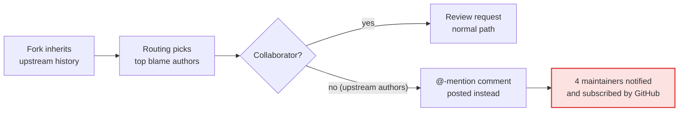
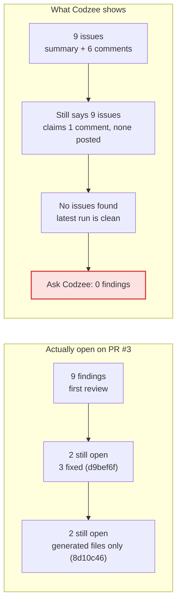

# Codzee Evaluation: Findings & Feedback

**Evaluator:** Sagolsem Hironika Devi ([@SagolsemHironika](https://github.com/SagolsemHironika)) · **Date:** 11 October 2026 · Codzee free trial (18 of 300 credits used)

> ⚠️ The open pull requests in this repository **contain mistakes on purpose**. They were planted to test Codzee. Don't deploy or reuse that code.

## Contents
1. [Summary](#summary)
2. [How I tested it](#how-i-tested-it)
3. [What Codzee does well](#what-codzee-does-well)
4. [Problem 1: Codzee notified people outside my project](#problem-1-most-serious-codzee-notified-people-outside-my-project)
5. [Problem 2: Codzee forgets problems after a change is updated](#problem-2-codzee-forgets-problems-after-a-change-is-updated)
6. [Problem 3: Codzee can't stop risky code from being merged](#problem-3-codzee-cant-stop-risky-code-from-being-merged)
7. [Problem 4: Codzee doesn't answer replies](#problem-4-codzee-doesnt-answer-replies)
8. [Problem 5: Dashboard numbers don't add up](#problem-5-dashboard-numbers-dont-add-up)
9. [Smaller issues](#smaller-issues)
10. [What Codzee missed](#what-codzee-missed)
11. [What I recommend](#what-i-recommend)
12. [Final verdict](#final-verdict)
13. [Appendix A: Every hidden mistake and Codzee's comment](#appendix-a-seeded-defect-ledger)
14. [Appendix B: Workflow tests](#appendix-b-workflow-tests-11-oct-2026-utc)

---

## Summary

I tested Codzee, an AI tool that reviews code changes on GitHub, by hiding mistakes in code on purpose and counting how many it found.

**The good news:** it found **21 of 24** hidden mistakes, raised **no false alarms**, and replied in under a minute each time. That's a strong result.

**The bad news:** Codzee is sharp the first time it looks at a change, but it loses track once the change is updated. It also sent notifications to people who have nothing to do with my project.

The three problems to fix first:

1. **It notified strangers.** Codzee tagged four well-known open-source developers on my changes, so GitHub alerted them.
2. **It forgets problems after an update.** After a small follow-up edit, Codzee's chat said a change had no problems when it still had two.
3. **It can't stop risky code.** Even with a serious security flaw reported, GitHub still showed the change as "Ready to merge".

**Key terms used in this document**

| Term | Meaning |
| --- | --- |
| Pull request (PR) | A proposed code change, waiting to be reviewed before it's accepted |
| Merge | Accepting a PR into the main code |
| Finding | A problem Codzee reports in its review |
| Commit | One saved update to the code; a PR can receive more commits after review |
| Fork | A personal copy of someone else's project on GitHub |
| Security flaw names | *SQL injection*, *XSS* and *IDOR* are common ways attackers read or change data they shouldn't |

---

## How I tested it

Think of it as a proofreading test: I wrote six pieces of code, hid mistakes in five of them, and left one completely clean.

1. I copied a popular open-source project (the FastAPI full-stack template) into my own GitHub account.
2. I made **6 realistic changes (PRs)**, each in a different area: search, login, database, speed, the web page, and one clean tidy-up.
3. Before Codzee looked, I wrote down every hidden mistake privately: **24 in total**, from serious to minor (see [Appendix A](#appendix-a-seeded-defect-ledger)).
4. I compared Codzee's review with my list: what it found, what it missed, and whether it complained about anything that was fine.
5. I then used Codzee the way a developer would: fixing code, applying its suggestions, replying to it, asking its chat, and checking its dashboard.

| PR | What the change does | Hidden mistakes | Found | False alarms | Review time |
| --- | --- | --- | --- | --- | --- |
| [#1](https://github.com/SagolsemHironika/full-stack-fastapi-template/pull/1) | Search and sort items | 4 | 3 | 0 | 42 s |
| [#2](https://github.com/SagolsemHironika/full-stack-fastapi-template/pull/2) | Lock accounts after failed logins | 5 | 4 | 0 | 67 s |
| [#3](https://github.com/SagolsemHironika/full-stack-fastapi-template/pull/3) | Undo deletes (database change) | 5 | 5 | 0 | 59 s |
| [#4](https://github.com/SagolsemHironika/full-stack-fastapi-template/pull/4) | Admin statistics | 4 | 4 | 0 | 50 s |
| [#5](https://github.com/SagolsemHironika/full-stack-fastapi-template/pull/5) | Search box on the web page | 6 | 5 | 0 | 51 s |
| [#6](https://github.com/SagolsemHironika/full-stack-fastapi-template/pull/6) | Clean tidy-up (no mistakes) | 0 | – | 0 | 29 s |
| **Total** | | **24** | **21 (87.5%)** | **0** | **about 50 s** |

**Where to check:** open any PR link above and scroll down the *Conversation* tab to Codzee's summary comment. Its line-by-line comments are under *Files changed*.

---

## What Codzee does well

On its first look at a change, Codzee behaves like a careful senior reviewer.

| Strength | Example | Where to check |
| --- | --- | --- |
| Finds real problems, no noise | 21 of 24 mistakes found; the clean tidy-up got "No issues found" | [PR #6](https://github.com/SagolsemHironika/full-stack-fastapi-template/pull/6) → Conversation tab |
| Explains the real danger | Showed the exact text an attacker could type to break the search | [PR #1 comment](https://github.com/SagolsemHironika/full-stack-fastapi-template/pull/1#discussion_r4241461211) |
| Puts numbers on risk | "5 guesses every 15 seconds, about 1,700 an hour per account" | [PR #2 comment](https://github.com/SagolsemHironika/full-stack-fastapi-template/pull/2#discussion_r4241467415) |
| Looks beyond the changed file | Read the server settings (`--workers 4`) to explain why the login lock fails | [PR #2 comment](https://github.com/SagolsemHironika/full-stack-fastapi-template/pull/2#discussion_r4241467424) |
| Isn't fooled by misleading notes | A code note claiming "this is safe" got: "The biome-ignore comment is wrong" | [PR #5 comment](https://github.com/SagolsemHironika/full-stack-fastapi-template/pull/5#discussion_r4241505924) |
| One-click fixes that work | The two suggestions I applied passed all CI checks | [PR #2 commits](https://github.com/SagolsemHironika/full-stack-fastapi-template/pull/2/commits), [PR #5 commits](https://github.com/SagolsemHironika/full-stack-fastapi-template/pull/5/commits) ("Apply suggestion…") |
| Fast | 29 to 67 seconds per review | Each PR → Checks tab → *Codzee review* |

---

## Problem 1 (most serious): Codzee notified people outside my project

Codzee suggests who should review each change. Because my project is a copy of a famous one, it picked the original project's maintainers, people who have never heard of me, and tagged them by name. GitHub then sent them a notification.

**What happened:** on PRs #2 to #5, Codzee posted a comment tagging four FastAPI maintainers. None of them has access to my project.

| PR | Tagged |
| --- | --- |
| #2 | @tiangolo, @patrick91 |
| #3 | @tiangolo, @alejsdev |
| #4 | @tiangolo, @alejsdev |
| #5 | @alejsdev, @YuriiMotov |

**Why it matters:** anyone who installs Codzee on a copied project will spam strangers, often well-known developers, and look unprofessional. Worse, GitHub also **subscribed** the four maintainers to these PRs, so any new activity there keeps notifying them until they unsubscribe themselves.

**What I did:** saved copies as evidence, deleted the four comments, and set "Reviewers to assign" to 0. After that, PR #6 got no tag.

**How to fix it:** only suggest people who can actually access the project, never fall back to tagging, and switch the feature off by default on copied projects.

**Where to check**
- **GitHub's permanent history** (the comments are deleted, but GitHub still records who was tagged). Open these and search the page for `"mentioned"` and `"subscribed"`:
  [PR #2](https://api.github.com/repos/SagolsemHironika/full-stack-fastapi-template/issues/2/timeline) · [PR #3](https://api.github.com/repos/SagolsemHironika/full-stack-fastapi-template/issues/3/timeline) · [PR #4](https://api.github.com/repos/SagolsemHironika/full-stack-fastapi-template/issues/4/timeline) · [PR #5](https://api.github.com/repos/SagolsemHironika/full-stack-fastapi-template/issues/5/timeline)
- **Codzee dashboard → Dashboard → "Active Team Members"** (right-hand panel): the four maintainers are listed as my team.
- **Codzee dashboard → Settings → Reviewer routing:** only "Reviewers to assign" and "Excluded logins"; there's no on/off switch.

---

## Problem 2: Codzee forgets problems after a change is updated

Codzee seems to remember only its **most recent** look at a change. If a later update is small and clean, the earlier problems disappear from its chat and dashboard, even though nobody fixed them.

**What happened, step by step**
1. I fixed 3 of Codzee's 5 findings on PR #3 (commit `d9bef6f`). Codzee's check said it had posted 1 new comment, but **no comment appeared**.
2. Its summary still listed **9 issues**, with an already-fixed problem at the top.
3. I then pushed an automatic, harmless update (commit `8d10c46`). Codzee said **"No issues found"**.
4. Its chat then told me PR #3 had **0 findings**. It still had 2 open problems. Asked which PRs have security issues, it also missed the open Critical XSS on PR #5.
5. The dashboard showed PR #1 as **"1 bug"**, though it still has 2 serious security findings.

**Why it matters:** a developer can make a serious warning vanish just by pushing any small update. That defeats the purpose of a review tool.

**How to fix it:** keep one running list of open findings per PR, use it everywhere, and update the summary on every push ("3 fixed, 2 still open").

**Where to check**
- **GitHub → [PR #3](https://github.com/SagolsemHironika/full-stack-fastapi-template/pull/3) → Conversation tab:** Codzee's summary still says "9 issues".
- **GitHub → [commit d9bef6f](https://github.com/SagolsemHironika/full-stack-fastapi-template/commit/d9bef6f)** → click the green check icon → *Codzee review*: it says "1 comment posted · 1 major", yet no such comment exists.
- **Codzee dashboard → Ask Codzee** (green button, bottom right): ask "Do PR #1 and PR #3 conflict with each other?" It answers that PR #3 has 0 findings.
- **Codzee dashboard → Dashboard → Needs Attention:** PR #1 is tagged "1 bug".

---

## Problem 3: Codzee can't stop risky code from being merged

Codzee's comment says "Changes requested", but its check on GitHub is always green. So GitHub shows **"Ready to merge"** even when Codzee has found a serious security flaw. Codzee's settings say teams should use GitHub's own merge rules, but those rules need Codzee to report a failure, and it never does.

**How to fix it:** an optional setting that makes the Codzee check fail when it finds a serious or security problem.

**Where to check:** GitHub → [PR #5](https://github.com/SagolsemHironika/full-stack-fastapi-template/pull/5) (Critical XSS flaw) → bottom of the Conversation tab: green "Codzee review" check and an active merge button. Codzee dashboard → Settings → Review behavior → *Suggested approvals*: "it doesn't block merges".

---

## Problem 4: Codzee doesn't answer replies

I replied to one of Codzee's comments with a reasonable question: why it rated a login flaw "Major" when a similar one was "Critical". Nearly 3 hours later there was still no answer. Developers often question a review, and a reviewer that can't respond leaves disagreements stuck.

**Where to check:** GitHub → [PR #2, my unanswered reply](https://github.com/SagolsemHironika/full-stack-fastapi-template/pull/2#discussion_r4241546824) (posted 12:22 UTC, 11 Oct 2026).

---

## Problem 5: Dashboard numbers don't add up

The dashboard shows different totals for the same thing, and some figures look good only because there's no data yet.

| Dashboard figure | What it shows | What is actually true |
| --- | --- | --- |
| Bug / security findings | 29 on the tile, 32 on the chart next to it | The same number should appear in both places |
| PRs reviewed | 12 | Only 6 PRs exist; it seems to count each re-check as a new PR |
| Acceptance rate | 100% | Shown before I accepted anything; later I accepted 2 of about 8 suggestions |
| Awaiting review | 0 | 5 PRs were open with unresolved problems |
| AI code % | about 100% | No explanation of how this is measured |

**Where to check:** Codzee dashboard → Dashboard: the top row of tiles and the *Findings Breakdown* chart.

---

## Smaller issues

None of these is urgent alone, but together they make Codzee harder to trust and use.

| Issue | In plain words | Where to check |
| --- | --- | --- |
| Repeats itself on auto-generated files | After an automatic update, it re-posted 2 serious warnings it had already made, this time on machine-generated files | [PR #1 repeat 1](https://github.com/SagolsemHironika/full-stack-fastapi-template/pull/1#discussion_r4241562703), [repeat 2](https://github.com/SagolsemHironika/full-stack-fastapi-template/pull/1#discussion_r4241562706) |
| Severity labels are inconsistent | A login flaw that lets attackers guess passwords was "Major", while a similar data leak was "Critical" | [PR #2 comment](https://github.com/SagolsemHironika/full-stack-fastapi-template/pull/2#discussion_r4241467408) vs [PR #1 comment](https://github.com/SagolsemHironika/full-stack-fastapi-template/pull/1#discussion_r4241461219) |
| Important points are hidden | Some serious findings sit in a collapsed section most readers won't open | [PR #3](https://github.com/SagolsemHironika/full-stack-fastapi-template/pull/3) summary → "3 more findings not posted inline" |
| Text is cut off | The headline problem in the summary stops mid-sentence ("…but ..."); a chat answer stopped mid-word | Any PR summary → "Top issue"; Ask Codzee answers |
| Misses clashes between changes | PR #1 and PR #3 both rewrite `backend/app/api/routes/items.py` and conflict, but Codzee only lists them as "possibly related" | PR #3 summary → "Possibly related PRs" |
| Chat can't see code or credits | Ask Codzee says it can't read the code, and can't tell me my credit use (Billing shows 18 / 300) | Codzee dashboard → Ask Codzee; Billing page |
| Billing is unclear | No list of what each review cost; my personal account is called a "GitHub organisation" | Codzee dashboard → Billing |
| Two checks for one review | GitHub lists both "Codzee review" and "codzee-app" | Any PR → Checks tab |
| Suggests 2 reviewers for a 1-person project | "Worth getting 2 people on this one" appears even with one developer | Any PR summary; Settings → Review behavior |
| Website and app disagree | The website lists a permission (Administration: read) that the install screen never asked for | codzee.io home page vs the GitHub install screen |
| No public documentation | The docs page returns "404 not found" | codzee.io/docs |

One positive note: when Ask Codzee couldn't answer, it said so honestly instead of making something up.

---

## What Codzee missed

Codzee missed 3 of the 24 hidden mistakes. All three are about data limits or tidying user input, not classic security attacks, which it catches very well.

| PR | Missed mistake, in plain words | Severity |
| --- | --- | --- |
| [#5](https://github.com/SagolsemHironika/full-stack-fastapi-template/pull/5) | The search box only searches the first 100 items, so later matches silently don't appear (`frontend/src/routes/_layout/items.tsx`) | Medium |
| [#1](https://github.com/SagolsemHironika/full-stack-fastapi-template/pull/1) | Typing `%` in the search matches everything, because special characters aren't handled (`backend/app/api/routes/items.py`) | Low |
| [#2](https://github.com/SagolsemHironika/full-stack-fastapi-template/pull/2) | `Name@x.com` and `name@x.com` count as different accounts for the login lock (`backend/app/core/login_throttle.py`) | Low |

---

## What I recommend

Start with the quick wins: they're cheap to build and remove the biggest risks. Then tackle the deeper fix, one shared list of open findings, which solves Problem 2 at its root.

| # | Recommendation | Impact | Effort |
| --- | --- | --- | --- |
| 1 | Only suggest reviewers with access; never fall back to @-mentions; off by default on forks | Stops harm to outsiders | Low |
| 2 | Keep one running list of open findings per PR, shared by the summary, chat and dashboard | Fixes forgotten findings | Medium |
| 3 | Update the summary on every push ("3 fixed, 2 still open") and close fixed threads | Reviews stay accurate | Medium |
| 4 | Optional setting: fail the Codzee check on serious/security findings | Lets teams block risky code | Low |
| 5 | Don't repeat open findings; skip generated files | Less noise, fewer credits wasted | Low |
| 6 | Reply when developers answer or question a finding | Feels like a teammate | Medium |
| 7 | Consistent dashboard numbers; show "–" instead of "100%" with no data | Trustworthy analytics | Low |
| 8 | Let Ask Codzee read the code and the credit balance | Useful chat | Medium |
| 9 | Explain how related PRs affect each other; warn when they clash | Catches cross-PR breakage | Medium |
| 10 | Publish documentation and a per-review credit log | Faster onboarding | Low |

**Small ideas that would make developers' lives easier**
- Show "what changed since the last review" each time a PR is updated.
- Let developers type `@codzee explain` or `@codzee ignore` in a comment.
- Explain each severity level on hover, so "Critical" and "Major" mean the same thing every time.

---

## Final verdict

I would happily use Codzee today as a **first reviewer**: it's accurate, fast and quiet. I wouldn't yet trust it to decide **whether a change is safe to merge**, because it notifies people outside the project, forgets problems after an update, and can't block risky code. Fixing the quick wins and the shared findings list would close most of that gap.

*As the task allowed, I used AI tools to help build the test changes and organise this write-up. Every finding links to evidence in this repository.*

---

## Appendix A: Seeded-defect ledger

I wrote this ledger privately **before** each review and published it only after all the reviews were in. "Caught" links to Codzee's comment.

### PR [#1](https://github.com/SagolsemHironika/full-stack-fastapi-template/pull/1): items search / sort / pagination
| ID | Sev | Defect | Codzee |
|---|---|---|---|
| D1.1 | Critical | SQL injection: only the first comma-separated `sort_by` segment is allow-listed, then the whole string goes into `text(f"{sort_by} {order}")` | ✅ Critical ([comment](https://github.com/SagolsemHironika/full-stack-fastapi-template/pull/1#discussion_r4241461211)) |
| D1.2 | High | IDOR: with `q`, `filters` is reassigned instead of appended, dropping the owner filter | ✅ Critical, with a correct suggestion ([comment](https://github.com/SagolsemHironika/full-stack-fastapi-template/pull/1#discussion_r4241461219)) |
| D1.3 | Medium | `count` is computed before the search filter, so pagination totals are wrong | ✅ Major ([comment](https://github.com/SagolsemHironika/full-stack-fastapi-template/pull/1#discussion_r4241461221)) |
| D1.4 | Low | LIKE wildcards in `q` aren't escaped | ❌ missed |

### PR [#2](https://github.com/SagolsemHironika/full-stack-fastapi-template/pull/2): login lockout
| ID | Sev | Defect | Codzee |
|---|---|---|---|
| D2.1 | High | The lock check runs only *after* successful auth: unlimited guessing, and a 429 reveals the correct password | ✅ Major ([comment](https://github.com/SagolsemHironika/full-stack-fastapi-template/pull/2#discussion_r4241467408)), under-rated |
| D2.2 | Medium | `LOGIN_LOCKOUT_MINUTES` is added as seconds (15s lockout) | ✅ Major, with a correct suggestion ([comment](https://github.com/SagolsemHironika/full-stack-fastapi-template/pull/2#discussion_r4241467415)) |
| D2.3 | Medium | In-memory per-process state with `--workers 4`, and unbounded growth | ✅ Major + Minor ([1](https://github.com/SagolsemHironika/full-stack-fastapi-template/pull/2#discussion_r4241467424), [2](https://github.com/SagolsemHironika/full-stack-fastapi-template/pull/2#discussion_r4241467439)) |
| D2.4 | Low | Counter increment isn't thread-safe | ✅ Minor ([comment](https://github.com/SagolsemHironika/full-stack-fastapi-template/pull/2#discussion_r4241467427)) |
| D2.5 | Low | Username isn't normalised (case/whitespace) | ❌ missed |

### PR [#3](https://github.com/SagolsemHironika/full-stack-fastapi-template/pull/3): soft delete + restore + migration
| ID | Sev | Defect | Codzee |
|---|---|---|---|
| D3.1 | High | NOT NULL column without `server_default`, so the migration fails on a populated table | ✅ Major, with a correct suggestion ([comment](https://github.com/SagolsemHironika/full-stack-fastapi-template/pull/3#discussion_r4241471519)) |
| D3.2 | Medium | `downgrade()` doesn't drop `is_archived` | ✅ Minor, with a correct suggestion ([comment](https://github.com/SagolsemHironika/full-stack-fastapi-template/pull/3#discussion_r4241471529)) |
| D3.3 | High | Restore has no ownership check | ✅ Critical, with a correct suggestion ([comment](https://github.com/SagolsemHironika/full-stack-fastapi-template/pull/3#discussion_r4241471516)) |
| D3.4 | Medium | Normal-user `count` includes archived items | ✅ Major (in the collapsed summary only) |
| D3.5 | Low | Archived items are still readable / editable by ID | ✅ Major (summary) + Minor ([comment](https://github.com/SagolsemHironika/full-stack-fastapi-template/pull/3#discussion_r4241471533)) |

### PR [#4](https://github.com/SagolsemHironika/full-stack-fastapi-template/pull/4): admin user stats
| ID | Sev | Defect | Codzee |
|---|---|---|---|
| D5.1 | Medium | N+1 queries: two queries per user | ✅ Major ([comment](https://github.com/SagolsemHironika/full-stack-fastapi-template/pull/4#discussion_r4241503908)) |
| D5.2 | Medium | `async def` route using a blocking sync DB session | ✅ (inside [comment](https://github.com/SagolsemHironika/full-stack-fastapi-template/pull/4#discussion_r4241503905)) |
| D5.3 | Medium | Loads whole tables into memory to count | ✅ Major ([comment](https://github.com/SagolsemHironika/full-stack-fastapi-template/pull/4#discussion_r4241503905)) |
| D5.4 | Medium | `/users/stats` is open to any logged-in user | ✅ Major, with a correct suggestion ([comment](https://github.com/SagolsemHironika/full-stack-fastapi-template/pull/4#discussion_r4241503893)) |

### PR [#5](https://github.com/SagolsemHironika/full-stack-fastapi-template/pull/5): frontend search with highlighting
| ID | Sev | Defect | Codzee |
|---|---|---|---|
| D4.1 | High | Stored XSS: item text is rendered via `dangerouslySetInnerHTML`, and only the query is escaped | ✅ Critical ([comment](https://github.com/SagolsemHironika/full-stack-fastapi-template/pull/5#discussion_r4241505924)) |
| D4.2 | Medium | Misleading `biome-ignore` justification suppresses the security lint | ✅ "The biome-ignore comment is wrong" (same comment) |
| D4.3 | Medium | Regex is built from an unescaped query, so `(` crashes the page | ✅ Major, with a correct suggestion ([comment](https://github.com/SagolsemHironika/full-stack-fastapi-template/pull/5#discussion_r4241505926)) |
| D4.4 | Medium | `useDebounce` never clears its timer | ✅ Minor, with a correct suggestion ([comment](https://github.com/SagolsemHironika/full-stack-fastapi-template/pull/5#discussion_r4241505942)) |
| D4.5 | Medium | Client-side search only covers the first 100 fetched items | ❌ missed |
| D4.6 | Low | A search with no matches shows "You don't have any items yet" | ✅ Minor (summary) |

### PR [#6](https://github.com/SagolsemHironika/full-stack-fastapi-template/pull/6): control (pure refactor, 0 seeded defects)
"No issues found", 0 comments: **0 false positives.** The OpenAPI schema is byte-identical before and after.

---

## Appendix B: Workflow tests (11 Oct 2026, UTC)

| Test | What I did | Result |
|---|---|---|
| Re-review | Fix commit `d9bef6f` on #3 (3 of 5 issues fixed) | ❌ Check says "1 comment posted", but none exists; summary stale; no threads resolved |
| Apply suggestion | Committed Codzee's suggestions on #2 (`* 60`) and #5 (`clearTimeout`) | ✅ Applied cleanly; re-review "No issues found"; thread resolved by GitHub, not Codzee |
| Generated-only commit | "regenerate API client" on #1, #3, #4 | ⚠️ #3/#4 clean; #1 got 3 comments on `*.gen.ts`, 2 of them duplicates of open Criticals |
| Conversation | Replied on #2 asking about severity and timing | ❌ No response from Codzee (checked hours later) |
| Routing | Default settings on a fork | ❌ @-mentioned 4 upstream maintainers on #2–#5 (comments deleted; evidence kept) |
| Routing = 0 | Set "Reviewers to assign" to 0, then opened #6 | ✅ No mention posted |
| Ask Codzee | 4 questions (security PRs, ownership check, #1 vs #3 conflict, credits) | ❌ Missed the Critical XSS; "0 findings" for #3; said #1/#3 don't overlap (they conflict); can't see code or credits |
| Dashboard | Before and after the follow-up commits | ❌ #1 went from "1 security" to "1 bug"; inconsistent totals |
